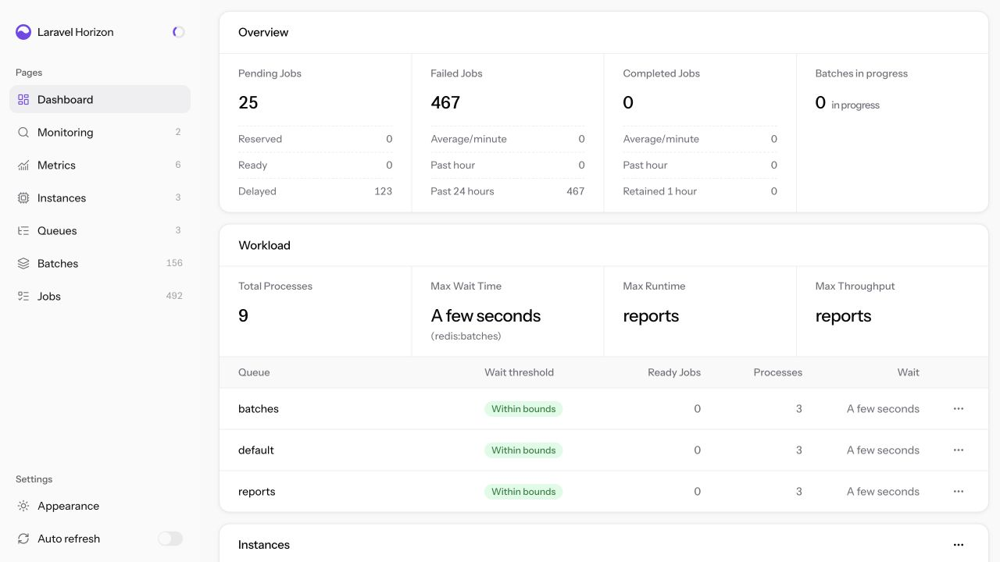

# Horizon New Dawn

> [!IMPORTANT]
> Horizon New Dawn is pre-1.0 software. Production use is supported only within
> the operating envelope documented below, and minor releases may contain
> documented breaking changes.

Horizon New Dawn replaces Laravel Horizon's bundled interface with a package-owned React 19 and Inertia 3 application while keeping Horizon's authorization, repositories, metrics, and queue workers in charge.

The package reads Horizon data in PHP and sends structured page props through Inertia. It does not add a second general browser-facing API layer. Horizon's API routes remain available; where New Dawn wraps a mutating handler, it preserves Horizon's authorization and adds only the safety or execution behavior documented below.



## Beyond the original Horizon interface

Compared with Horizon's bundled interface, New Dawn adds:

- full retained-source search for pending, completed, and silenced jobs by
  case-insensitive partial job class or exact retained ID, composable with exact
  job class, queue, connection, and pending-state filters;
- Horizon's exact failed-tag filtering and fast client-side sorting across every
  job row currently loaded by infinite scrolling;
- exact database-backed batch search, status tabs, queue and connection filters, creation ranges, counts, and server-side sorting;
- Horizon instance management, with controls to pause or continue individual local instances and terminate local instances;
- supervisor controls and detailed configuration views covering scaling, balancing, process limits, memory, timeouts, retries, backoff, and configuration warnings;
- queue management, including timed or indefinite pauses, resuming, clearing one or all queues, and retrying failures for a specific queue;
- individual and bulk cancellation of eligible pending jobs, while protecting batched jobs so they are cancelled through their batch;
- bulk and scoped failure recovery, with controls to retry or remove one failed job, retry or clear all failures, and retry failures by queue, monitored tag, or batch;
- batch management, including cancelling active batches, retrying failed batch jobs, clearing retained failures, and clearing finished batches.

## Requirements

- PHP 8.3 or newer
- Laravel 12.38 or newer, or Laravel 13
- Laravel Horizon 5.46.0 or newer within the 5.x series

These floors are deliberate:

- PHP 8.3 is the lowest PHP version covered by the package's release matrix. New Dawn does not claim compatibility with runtimes it does not continuously test.
- Laravel 12.38 contains the framework fix needed to register console commands correctly with current Symfony Console releases. Earlier Laravel 12 releases can fail while booting Artisan. Laravel 11 is excluded because it is end-of-life.
- Horizon 5.46.0 is the oldest Horizon release exercised by New Dawn's full package suite, real Redis worker smoke test, and consuming-application browser checks. Older Horizon releases are not part of the supported contract.

Queue pausing is available when the installed Laravel version provides its complete queue-pause API (Laravel 12.40.2 or newer). On Laravel 12.38 through 12.40.1, New Dawn hides only the unsupported pause and resume controls; retrying failures and clearing queues remain available.

Standalone Redis 6.2 or newer and standalone Valkey 8 are supported with
Predis and PhpRedis. Redis Cluster is not currently supported. Queue metadata
cleanup and retained-job index reconciliation use commands such as
`ZDIFFSTORE` that have not yet been made cluster-slot aware.

Use `maxmemory-policy noeviction` for the Redis or Valkey instance that stores
Horizon queues and New Dawn's retained-job indexes, and provision enough memory
for the configured retention windows. An `allkeys-*` policy may silently remove
queue or index keys under pressure. With `noeviction`, writes fail visibly
instead; monitor memory use and command errors so capacity can be increased
before that happens. Leave headroom beyond the persistent retained indexes:
reconciliation, search, and filtered queries use short-lived Redis union and
intersection sorted sets, while pending-state requests may copy live queue
structures into temporary snapshots.

New Dawn reads and mutates batches through the application's configured
`BatchRepository`, including Laravel's database and DynamoDB implementations.
Exact full-history batch search, status and creation filters, counts, and
sorting require Laravel's `DatabaseBatchRepository`. Queue and connection
filters, queue-attributed batch summaries, and queue-level batch retry also
require New Dawn's metadata migration; those destination-dependent features are
hidden until the migration has run, while the source-column SQL features remain
available. With another repository, New Dawn keeps generic batch browsing and
actions but hides the query controls it cannot make exact. This does not make
DynamoDB a Horizon queue backend: Horizon still requires Redis for queues and
supervisors. The exact SQL query path supports MariaDB, MySQL, PostgreSQL, and
SQLite; applications using another database driver receive the same truthful
generic fallback.

Bulk mutations run as package-owned queued jobs. The configured bulk-operation
connection must therefore use an asynchronous queue driver that is processed by
Horizon. New Dawn refuses these operations on `sync` and `null` drivers.
Retry all and Clear all on the failed-jobs page use Horizon's global retained
failure set at the moment the coordinator job starts, not the current filter
result. The HTTP request only authorizes, validates the bulk connection, and
enqueues one coordinator; workers process every eligible retained target in
bounded snapshot chunks with safe continuations.

## Installation

Install and configure Laravel Horizon in the host application first. Then install New Dawn and publish its compiled assets:

```bash
composer require nckrtl/horizon-new-dawn:^0.1.0
php artisan horizon-new-dawn:install
php artisan migrate
```

The installer publishes configuration and compiled assets, and appends
`@php artisan horizon-new-dawn:assets --ansi` to the root application's
`scripts.post-autoload-dump` so later `composer install` and `composer update`
runs refresh published assets automatically. Use `--no-composer-hook` to skip
that edit. Pass `--force` only when you intentionally want to republish an
otherwise current build.

Visit the host application's existing Horizon path, which is `/horizon` by default. New Dawn honors Horizon's configured path and domain and uses Horizon's existing authorization callback and middleware.

After the first install, package updates usually need no extra asset step:
Composer’s `post-autoload-dump` runs `horizon-new-dawn:assets` and replaces the
package-owned `public/vendor/horizon-new-dawn/build` directory when the published
build is missing, partial, stale, or contains files not present in the current
package build. An exact match is a no-op. Republish config or re-check
production prerequisites with the full installer:

```bash
php artisan horizon-new-dawn:install
php artisan migrate
```

Publish or refresh assets alone with:

```bash
php artisan horizon-new-dawn:assets
```

If Composer scripts are disabled (`--no-scripts`) or the hook was not added,
run `php artisan horizon-new-dawn:assets` after installs and updates. No Node.js
or frontend build is required in the consuming application.

## Production deployment

New Dawn's interface includes actions that mutate Horizon, Redis, and batch
state. Validate a release against a production-like environment and backup or
retention policy before exposing those actions to operators.

New Dawn uses Horizon's existing `Horizon::auth` callback, normally backed by
the `viewHorizon` Gate, as the single authorization boundary for the whole
dashboard, including every read and mutation. Anyone Horizon admits can use
every action New Dawn exposes. Before exposing the dashboard outside a local
environment, verify that the application's Horizon authorization admits only
trusted operators.

Choose a durable, asynchronous connection and a queue that is consumed by
Horizon for bulk operations:

```php
'bulk_operations' => [
    'connection' => 'redis',
    'queue' => 'horizon-maintenance',
],
```

Bulk-operation jobs inherit the consuming Horizon supervisor's timeout. Keep
that timeout several seconds below the selected Redis connection's
`retry_after`, and configure the process manager's shutdown allowance above the
longest permitted job runtime. Each continuation performs a fixed-size page of
work and requeues itself until the point-in-time target snapshot is exhausted,
so supervisor timeouts need only cover one chunk plus snapshot bookkeeping.

A successful dispatch response confirms only that the bulk coordinator entered
the queue. Temporary Redis snapshot state is namespaced and renewed while
continuations run; it is not limited by a one-hour runtime or item-count
ceiling. Abandoned state that is never renewed eventually expires, and a later
continuation then fails closed with an explicit missing-state error. Snapshot
members are acknowledged only after a terminal outcome so interrupted chunks
can be retried without silently skipping unprocessed targets. Completion and
failure records are written to the application log, and execution failures also
appear in Horizon's failed-jobs view for inspection and retry.

Global failed-job retry and clear actions are never rejected solely because the
retained count is large. New failures retained after the coordinator captures
its snapshot are outside the operation boundary and do not make the run
endless.

Repository-wide batch scans used by summaries, filter catalogs, and generic
fallback bulk preflights walk the complete retained history page-by-page with
no configurable total ceiling. Malformed or non-advancing repository pages
fail closed. Database-backed search, status and creation filters, counts,
sorting, and SQL batch-clear classification keep their optimized paths. Queue
and connection filters additionally require the package metadata migration.

Applications using Laravel's database batch repository should schedule
`queue:prune-batches` with retention options appropriate for that application.
Applications using Laravel's DynamoDB batch repository must configure the
repository's native TTL through `queue.batching.ttl_attribute` and
`queue.batching.ttl` instead; Laravel's batch-pruning command does not prune
DynamoDB batches.

Set Horizon's `trim.pending` visibility window longer than the longest delay or
release interval used by batch jobs. Otherwise Horizon may trim pending
metadata before a destructive preflight can see an active delayed job.

For applications that cache routes or configuration, use this update order:

```bash
php artisan optimize:clear
composer install --no-dev
php artisan migrate --force
php artisan config:cache
php artisan route:cache
```

When Composer scripts run, `post-autoload-dump` refreshes New Dawn assets via
`horizon-new-dawn:assets`. With `--no-scripts`, or when shipping immutable
artifacts that already include `public/vendor/horizon-new-dawn/build`, skip the
Artisan publish step on deploy nodes. Otherwise run
`php artisan horizon-new-dawn:assets` (or the full installer) on each node after
Composer. Publication replaces the whole package-owned
`public/vendor/horizon-new-dawn/build` tree from a validated staged copy, so a
request either sees the previous tree or the new one—not a mixed generation.
There can be a brief gap while the destination is swapped.

If you are adopting the retained-job filters in an existing production Horizon
deployment, you may optionally prebuild both request-reconciled indexes once
after deployment:

```bash
php artisan horizon-new-dawn:warm-batch-metadata
php artisan horizon-new-dawn:warm-retained-jobs
```

Run `horizon-new-dawn:warm-batch-metadata` only after the package migration is
present. The retained-job warm command does not require that SQL table. Neither
warm-up is required on every deploy. New Dawn still reconciles newly retained
records on requests; the commands exist to keep the first operator request from
paying the initial full-history reconciliation cost.

Request reconciliation adds newly retained jobs immediately, while every exact
query intersects a point-in-time Horizon source snapshot so expired projection
members cannot appear in results. Removing stale projection members is
maintenance rather than a serving requirement. Long-lived, high-throughput
applications should therefore schedule `horizon-new-dawn:warm-retained-jobs`
outside peak traffic at a cadence appropriate for their Horizon retention and
throughput, using Laravel's `withoutOverlapping()` guard. This bounds package
index storage without making page correctness depend on the scheduler.
If another reconciliation already owns a retained-type synchronization lock,
the warm command fails instead of claiming that stale cleanup completed; rerun
it after that reconciliation finishes.

The projection stores immutable metadata and facet memberships for Horizon's
retained jobs, so its Redis memory use and first reconciliation cost scale with
the application's configured Horizon retention windows. Tune
Horizon's `trim` values for the history operators actually need, and monitor
Redis memory and command latency after enabling the filters. Pending-state
filters remain request-time rather than persistently cached. Each filtered
request atomically copies the relevant ready or reserved structure, or stores
the matching delayed score window, into short-lived snapshot keys before
scanning it in chunks. The snapshot TTL is renewed while it is read and the
keys are deleted afterward. This prevents workers from shifting live offsets
and silently omitting jobs, but its request work and transient memory scale
with the selected queues' current backlog. A released-state request may
temporarily hold both a ready-list copy and the due portion of the delayed set.
Leave Redis or Valkey headroom for that snapshot in addition to the persistent
projection and temporary query intersections.

New Dawn excludes its configured Horizon route tree from the host application's
Inertia SSR gateway because the package intentionally ships a client-only
bundle. It also uses Laravel's Vite CSP nonce for its bootstrap script, package
Vite entry tags, and Inertia runtime styles.

Some React components use inline style attributes for runtime geometry. CSP
deployments must permit those attributes; policies with
`style-src-attr 'none'` are outside the supported production envelope.

After package or configuration changes, restart Horizon and any long-lived
application process such as Octane or FrankenPHP so workers do not retain old
code or configuration:

```bash
php artisan horizon:terminate
php artisan octane:reload
```

Use the command appropriate for the host runtime when Octane is not installed.
The built frontend explicitly targets Vite's `baseline-widely-available`
browser set.

To populate the metrics pages, schedule Horizon's snapshot command every five minutes in the host application's `routes/console.php`:

```php
use Illuminate\Support\Facades\Schedule;

Schedule::command('horizon:snapshot')->everyFiveMinutes();
```

Rollback by restoring the prior Composer lock file and application release,
running that release's installer, rebuilding Laravel's caches, and restarting
the long-lived processes. Redis Cluster remains outside the supported
production envelope.

## Reverting to the original Horizon interface

Remove Horizon New Dawn, reinstall Horizon's resources, and clear the application's cached configuration and routes:

```bash
composer remove nckrtl/horizon-new-dawn
php artisan horizon:install
php artisan optimize:clear
```

The original Horizon interface will then be available at the application's existing Horizon path. Current Horizon releases load their compiled interface assets directly from the `laravel/horizon` package, so the deprecated `horizon:publish` command is not required.

## Interface

New Dawn provides dedicated Inertia routes for:

- the dashboard, system status, supervisors, workload, throughput, and wait times;
- pending, completed, silenced, and failed job lists with job detail pages;
- retrying one failed job or all failed jobs;
- monitored tags with completed and failed job views;
- job and queue metrics with historical snapshots;
- job batches, batch search, batch progress, failed jobs, and batch retry.

The interface uses a persistent responsive layout composed from shadcn/ui
primitives. It supports light, dark, and system themes; exact server-sorted
database batch tables; client-sorted job tables; Inertia-powered infinite
scrolling; optional automatic refreshes; responsive navigation; and Inertia
mutations with toast feedback. Generated Wayfinder routes are rebased at
runtime, so links and actions continue to work with a custom Horizon path or an
absolute domain URL.

On the pending, completed, and silenced Jobs pages, search examines Horizon's
complete retained source before the 50-row page is selected. A term matches any
job class that contains it case-insensitively, or the retained job whose ID
matches it exactly. Those alternatives are combined with OR, then intersected
with any active exact job class, queue, connection, and pending-state filters.
The Failed Jobs search remains Horizon's exact tag query.

New Dawn maintains package-owned Redis projections of immutable job metadata
and reconciles them from Horizon on requests; it does not require an event
listener, scheduler, or background indexing process. Full-source search reuses
that projection and adds no persistent search-specific index. When a search
matches multiple class facets or an exact retained ID, New Dawn creates only
short-lived Redis union and query keys, deletes them after the request, and
retains a short expiry as cleanup fallback.

Unfiltered list totals and time-window counts read Horizon's retained sorted
sets directly. Exact filter catalogs share one retained-source snapshot per
job type, expose only values still represented in that snapshot, and reuse a
job's cached immutable class, queue, connection, and tags when it moves between
pending and terminal history. The browser requests a catalog only when the
filter trigger is hovered, focused, or opened. Normal list polling excludes
catalogs, and successful catalog responses are reused for one configured poll
interval.

Partial job-class search unions every matching retained class. Redis union and
catalog work is split into internal bounded command chunks so no single command
receives an unbounded key list and retained job records are not fully
materialized. A term that matches every retained class uses the existing
projection directly. Intent-loaded exact-filter catalogs return every distinct
current job class, queue, and connection value, reading Redis catalog data in
internal bounded pages; the final option list is output-sized.

Pending rows retain Horizon's enqueue chronology while their ready, delayed,
released, or reserved state is resolved from a point-in-time snapshot of the
live queue structures.

Sortable job headers on the main job lists and queue activity views reorder
every row currently loaded in the browser. Sorting does not make another
request and is intentionally not a global retained-history sort. Infinite
scrolling still requests the next 50 rows in Horizon's retained order; after
those rows arrive, the combined loaded collection is sorted again. Numeric
nulls remain last in either direction. Pending jobs support Job and Queued;
completed and silenced jobs additionally support Completed and Runtime; failed
jobs support Job, Runtime, and Failed. Monitored-tag lists keep Horizon's
repository order.

Pending State remains an exact request-time server filter. Its badge can change
when a job moves between ready, reserved, and delayed structures or crosses its
release time. Each state-filter request uses one immutable, point-in-time queue
snapshot so a worker cannot make the scan itself omit members. Jobs explicitly
made available by New Dawn are classified as Ready, matching their displayed
badge; naturally elapsed schedules remain Released.

For database-backed batches, New Dawn stores one immutable queue and connection
snapshot per retained batch in `horizon_new_dawn_batch_metadata`. Explicit batch
options are preserved. When an older batch omitted an option, its value is
inferred once from the application's queue configuration when New Dawn first
discovers that batch. The interface labels that provenance because a default
that changed before first discovery cannot prove the batch's historical
physical destination. Once captured, the snapshot does not change when
configuration changes. Lifecycle counts and status always come directly from
Laravel's `job_batches` table.

Horizon API routes remain available under Horizon's existing authorization
boundary. Read responses keep Horizon's existing contract. Monitoring
mutations also apply New Dawn's reserved-key and currently-monitored tag guards,
while bulk operations retain their bounded asynchronous execution safeguards.
Unsupported legacy UI paths return `404` instead of silently falling back to
Horizon's Vue application.

## Configuration

Publish the configuration when you need to change defaults:

```bash
php artisan vendor:publish --tag=horizon-new-dawn-config
```

```php
return [
    'poll_interval' => 5000,
    'job_navigation_breakdown' => false,
    'job_payload_allowed_classes' => [],
    'bulk_operations' => [
        'connection' => null,
        'queue' => null,
    ],
];
```

Set `job_navigation_breakdown` to `true` to show Pending, Failed, Completed,
and Silenced links below the Jobs navigation item. It is hidden by default;
the Jobs item itself always links to Pending.

`job_payload_allowed_classes` is a legacy compatibility escape hatch for
releasing unique-job locks from serialized queue commands. Keep it empty unless
an exact trusted job class must be instantiated; the safe default relies on
Laravel's serialized queue context and never instantiates arbitrary payload
classes. PHP deserialization may invoke lifecycle methods such as `__wakeup`
and `__destruct`, so allow only side-effect-free classes controlled by the
application.

## Upstream Horizon sync

`horizon-sync.json` records the Horizon release this package is verified against and the upstream surface it already implements. `synced_tag` is `v5.50.1`, the newest `laravel/horizon` tag for which `composer test:compatibility` passed. The `surface` list contains only routes, controller actions, Vue screens, and config keys this package covers. Each entry names the package file that covers it. Upstream items this package does not implement are omitted; a later detection run reports them as candidates.

Detect the next upstream tag. The command prints JSON and does not change the package:

```bash
php scripts/horizon-sync detect
```

It reads `horizon-sync.json`, lists tags from `https://github.com/laravel/horizon.git`, and text-diffs only the next newer tag. Set `HORIZON_SYNC_REMOTE` to a local Horizon checkout when you do not want a network fetch.

## Development

```bash
composer install
bun install
php vendor/bin/testbench workbench:build
composer quality
bun run format:check
bun run lint
bun run test
bun run typecheck
bun run build
```

Regenerate typed Horizon route helpers after route changes:

```bash
bun run wayfinder:generate
```

The package includes an Orchestra Workbench application with deterministic successful and failing queue jobs for exercising the interface.

## License

Horizon New Dawn is open-source software licensed under the MIT license.
